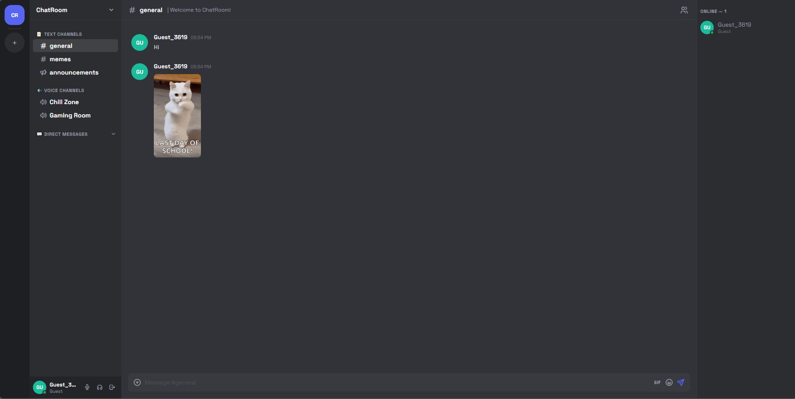

# 💬 ChatRoom — Mini-Discord Chat App

Full-featured real-time chat application with rooms, DMs, voice chat, GIFs, emoji, and admin tools.



## ✨ Features

| Feature | Details |
|---|---|
| 🏠 Rooms | Text, Voice, and Announcement channels |
| 💬 DMs | Private direct messages between users |
| 🎙️ Voice Chat | WebRTC peer-to-peer voice in rooms |
| 🎉 GIFs | Search & send GIFs via Tenor API |
| 😀 Emoji | Full emoji picker with categories + reactions |
| 🔐 Auth | Email/Password, Google OAuth, Guest mode |
| 🛡️ Admin | Ban/unban users, assign moderators, clear chat, delete messages |
| 📊 Online Status | Online, Idle, DND, Offline |

---

## 🚀 Setup

### 1. Clone & Install

```bash
git clone [<your-repo>](https://github.com/ramykatour/Mini-Discord)
cd chatroom
npm install
```

### 2. MySQL Database

```bash
mysql -u root -p < database/schema.sql
```

### 3. Environment Variables

```bash
cp .env.example .env
# Edit .env with your values
```

Required values in `.env`:
```
DB_HOST=localhost
DB_USER=root
DB_PASSWORD=yourpassword
DB_NAME=chatroom

JWT_SECRET=change_this_to_random_string
SESSION_SECRET=change_this_too

# Tenor API (free): https://developers.google.com/tenor/guides/quickstart
TENOR_API_KEY=your_tenor_key

# Google OAuth (optional): https://console.cloud.google.com
GOOGLE_CLIENT_ID=your_client_id
GOOGLE_CLIENT_SECRET=your_client_secret
GOOGLE_CALLBACK_URL=http://localhost:3000/auth/google/callback
```

### 4. Create First Admin User

After registering, run this SQL to make yourself admin:
```sql
USE chatroom;
UPDATE users SET role='admin' WHERE email='your@email.com';
```

### 5. Run

```bash
# Development (with auto-restart)
npm run dev

# Production
npm start
```

Open **http://localhost:3000**

---

## 📁 Project Structure

```
chatroom/
├── server/
│   ├── index.js       # Express + Socket.IO entry point
│   ├── db.js          # MySQL connection pool
│   ├── auth.js        # Login, Register, Guest, Google OAuth
│   ├── passport.js    # Google OAuth strategy
│   ├── middleware.js  # JWT auth, admin/mod guards
│   ├── rooms.js       # Rooms & messages REST API
│   ├── dms.js         # Direct messages REST API
│   ├── admin.js       # Admin REST API (ban, mod, clear)
│   ├── gifs.js        # Tenor GIF API proxy
│   └── socket.js      # All Socket.IO real-time events
├── public/
│   ├── pages/
│   │   ├── app.html      # Main chat UI
│   │   ├── login.html    # Login page
│   │   └── register.html # Register page
│   └── js/
│       ├── app.js        # Client-side logic
│       └── voice.js      # WebRTC voice chat
└── database/
    └── schema.sql        # MySQL schema + seed data
```

---

## 🔌 Socket.IO Events

### Client → Server
| Event | Payload | Description |
|---|---|---|
| `room:join` | `roomId` | Join a room |
| `message:send` | `{roomId, content, type, gifUrl}` | Send message |
| `message:delete` | `{messageId, roomId}` | Delete message (mod+) |
| `room:clear` | `{roomId}` | Clear all messages (mod+) |
| `reaction:toggle` | `{messageId, emoji, roomId}` | Add/remove reaction |
| `dm:send` | `{toUserId, content, type, gifUrl}` | Send DM |
| `dm:typing` | `{toUserId}` | DM typing indicator |
| `room:typing` | `{roomId}` | Room typing indicator |
| `voice:join` | `{roomId}` | Join voice channel |
| `voice:leave` | `{roomId}` | Leave voice channel |
| `voice:offer` | `{toPeerId, offer}` | WebRTC offer |
| `voice:answer` | `{toPeerId, answer}` | WebRTC answer |
| `voice:ice` | `{toPeerId, candidate}` | ICE candidate |
| `voice:mute` | `{roomId, muted}` | Mute status |
| `admin:ban` | `{userId, reason, duration}` | Ban user |
| `admin:set-mod` | `{userId}` | Promote to moderator |
| `status:set` | `{status}` | Set online status |

### Server → Client
| Event | Description |
|---|---|
| `message:new` | New message in room |
| `message:deleted` | Message was deleted |
| `room:cleared` | Room chat cleared |
| `reaction:update` | Reactions updated |
| `dm:new` | New DM received |
| `user:status` | User online/offline |
| `system:message` | System notification |
| `banned` | You were banned |
| `role:update` | Your role changed |
| `voice:peers` | Existing voice users |
| `voice:user-joined` | User joined voice |
| `voice:user-left` | User left voice |
| `voice:members` | Voice room member list |

---

## 🔒 Admin Roles

| Role | Permissions |
|---|---|
| `admin` | Everything — ban, unban, assign mods, delete messages, clear rooms, create channels |
| `moderator` | Delete messages, clear rooms, ban regular users |
| `user` | Send messages, react, use DMs, join voice |
| `guest` | Same as user but no account (temporary) |

---

## 🌐 Deployment Notes

- Use **HTTPS** in production (required for WebRTC mic access)
- Set `NODE_ENV=production` in your `.env`
- Use **nginx** as a reverse proxy with Socket.IO support:

```nginx
location / {
    proxy_pass http://localhost:3000;
    proxy_http_version 1.1;
    proxy_set_header Upgrade $http_upgrade;
    proxy_set_header Connection "upgrade";
    proxy_set_header Host $host;
}
```

- For voice chat across different networks, consider adding a **TURN server** to the WebRTC config in `public/js/voice.js`
